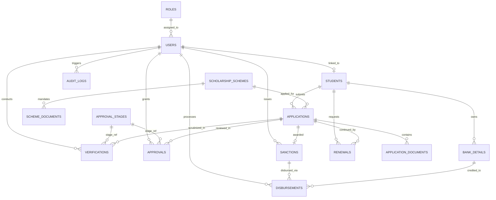

# University Scholarship and Financial Aid Management System (SFAMS)
### Academic DBMS Project & Enterprise Financial Aid Web Application

[](LICENSE)
[](https://nodejs.org/)
[-blueviolet.svg)](database/schema.sql)
[](#)

A modern, responsive, role-based web application for managing university scholarship schemes, student applications, document verification, multi-stage approval workflows, financial sanctions, and Direct Benefit Transfer (DBT/PFMS) disbursements. Built on a strict **Third Normal Form (3NF)** relational database architecture with zero-leak identity isolation.

---

## 🌟 Key Features

1. **Role-Based Access Control (RBAC) & Single Sign-On Gateway**:
   - **Student Portal**: Authenticated using Roll Number (e.g. `25WU0102085`) and password. Displays strictly the authenticated student's personal academic records, application tracking, DBT account status, and eligible schemes. Prevents viewing other students' data or university-wide financial balances.
   - **Faculty Desk (Document Verifiers & Deans)**: Certificate inspection desk, simulated document preview, defect logging, and multi-level approval clearance.
   - **University Directorate & Treasury**: System-wide scheme configuration, student directories, financial sanctions, PFMS payment execution with printable bank vouchers, and live DBMS SQL Studio.

2. **3NF Relational Database Architecture**:
   - 15 Normalized Tables: `roles`, `users`, `students`, `scholarship_schemes`, `scheme_documents`, `applications`, `application_documents`, `verifications`, `approval_stages`, `approvals`, `sanctions`, `bank_details`, `disbursements`, `renewals`, `audit_logs`.
   - Constraints: Primary Keys, Foreign Keys, `UNIQUE(student_id, scheme_id, academic_year)` to prevent duplicate submissions, and `CHECK` constraints on amounts, GPA, and percentages.
   - 5 Predefined Views: `Pending_Applications_View`, `Eligible_Students_View`, `Approved_Applications_View`, `Disbursement_Report_View`, `Scheme_Statistics_View`.
   - 📄 **Full Data Dictionary & Schema Documentation**: See [docs/ER_DIAGRAM.md](docs/ER_DIAGRAM.md).

---

## 📊 Entity-Relationship (ER) Diagram

The following ER model depicts all 15 normalized tables, primary keys (`PK`), foreign keys (`FK`), and relational cardinalities:



> 📖 **Comprehensive Cardinality & Table Specifications**: View [docs/ER_DIAGRAM.md](docs/ER_DIAGRAM.md) for the complete entity dictionary and 3NF normalization proof.

---

3. **Enforced Relational Business Rules**:
   - 🔒 **One Application Limit**: Prevents a student from applying more than once for the same scheme in an academic year.
   - 🔒 **Eligibility Barrier**: Automatically blocks submissions failing minimum CGPA, percentage, income limits, or attendance.
   - 🔒 **Document Verification Prerequisite**: Applications cannot be approved without verified supporting documents.
   - 🔒 **Sanction Ceiling**: Sanctioned amount can never exceed the maximum grant limit defined by the scheme.
   - 🔒 **Disbursement Ceiling**: Total payments can never exceed the sanctioned amount.
   - 🔒 **Bank Validation**: Payments can only be disbursed to accounts authenticated by the Finance Section.

4. **Academic DBMS Explorer & SQL Studio**:
   - **Live SQL Console**: Run custom relational SQL queries with millisecond execution timers, column headers, and row views.
   - **Predefined Exam Queries**: One-click execution of multi-table `INNER JOIN`, `LEFT JOIN`, `GROUP BY` with `HAVING`, correlated subqueries, aggregate statistics, and ACID transaction scripts.
   - **Interactive ER Diagram**: Visual table cards displaying Primary Keys (🔑), Foreign Keys (🔗), data types, and cardinality.
   - **MySQL 8.0 DDL Export**: Downloadable `mysql_schema.sql` file ready for import into MySQL Workbench or phpMyAdmin.

5. **Analytical Dashboard & Reporting with Interactive Drill-Downs**:
   - 11 Real-Time Interactive KPI Cards with one-click drill-downs:
     - 🎓 **Clicking "Total Students"**: Opens modal with student roster, roll numbers, academic CGPA, department, and family income.
     - 📜 **Clicking "Active Schemes"**: Opens directory with internal 3NF university schemes AND official national portal references (NSP, AICTE, DST INSPIRE, UGC, Reliance, Tata Trusts).
     - 📝 **Clicking "Total Applications"**: Displays application registry with full student credentials, stages, and status.
     - 🏛️ / 💸 **Clicking "Sanctioned / Disbursed Amount"**: Opens the financial ledger with UTR numbers and printable vouchers.
   - Custom SVG charts: Applications by Scheme, Lifecycle Status Donut, Sanctioned vs Disbursed Comparisons, Department Beneficiary Distributions, and Monthly Disbursements Trend.
   - Multi-parameter filtering with **CSV Export** and **Printable Official Letterhead / Voucher Views**.

6. **External National Portals & Central Scheme References**:
   - Curated references to official scholarship authorities with live links:
     - **National Scholarship Portal (NSP)** — *scholarships.gov.in* (CSSS Scheme)
     - **AICTE** — *aicte-india.org* (Pragati & Saksham Schemes)
     - **DST INSPIRE** — *online-inspire.gov.in* (SHE Scheme)
     - **UGC** — *ugc.gov.in* (Ishan Uday Special Scheme)
     - **Reliance Foundation & Tata Trusts**

---

## 🌐 Live Public Link & Permanent Cloud Deployment

### 1. Current Live Link (Local Tunnel)
You can access and share the live application over the internet at:
**[https://permapath.vercel.app/](https://permapath.vercel.app/)**
*(Secured with Cloudflare Edge SSL — No password or configuration required)*

### 2. Permanent 24/7 Cloud URL (Render.com)
Deploy this repository to **Render** for a free, permanent 24/7 live URL (`https://<your-app-name>.onrender.com`) that never changes and stays online even when your computer is shut down:

[](https://render.com/deploy?repo=https://github.com/udaykiranreddygoparapu-ship-it/scholarship-management-system)

---

## 🚀 How to Run Locally

### Prerequisites
- Node.js (v18 or higher) and npm installed.

### 1. Installation
```bash
npm install
```

### 2. Start the Server
```bash
npm start
# or
npm run dev
```

### 3. Open in Browser
Visit: **[https://permapath.vercel.app/](https://permapath.vercel.app/)**

---

## 👥 Built-in Personas & Test Credentials

Select the matching tab on the Login Gateway:

| Portal Tab | Role / Context | Username / Roll No | Password | Description |
| :--- | :--- | :--- | :--- | :--- |
| **🎓 Student Portal** | Merit Scholar | `25WU0102085` *(or rahul.sharma)* | `student123` | B.Tech CSE &bull; 8.85 CGPA &bull; Personal dashboard only |
| **🎓 Student Portal** | Pragati Scholar | `25WU0102086` *(or priya.patel)* | `student123` | B.Tech ECE &bull; 9.42 CGPA &bull; Personal dashboard only |
| **👨‍🏫 Faculty Desk** | Verification Officer | `verifier` | `verifier123` | Dr. Suresh Rao &bull; Document scrutiny desk |
| **👨‍🏫 Faculty Desk** | Approving Authority | `approver` | `approver123` | Prof. A. K. Verma &bull; Dean Academic Affairs |
| **🏛️ Directorate** | System Administrator | `admin` | `admin123` | Prof. Dr. Rajesh K. Sharma &bull; DSW & System Governance |
| **🏛️ Directorate** | Comptroller & Finance | `finance` | `finance123` | Mrs. Kavita Nair &bull; PFMS Direct Benefit Transfer |

---

## 📁 Repository Structure

```
├── .github/
│   └── workflows/
│       └── ci.yml                 # Automated GitHub Actions CI workflow
├── .gitignore                 # Excludes node_modules, binaries, OS and log files
├── docs/                      # Technical Documentation
│   └── ER_DIAGRAM.md          # 3NF ER Diagram & Comprehensive Data Dictionary
├── LICENSE                    # MIT Open Source License
├── README.md                  # Comprehensive documentation and setup guide
├── package.json               # Project manifest, dependencies and scripts
├── package-lock.json          # Dependency lockfile
├── server.js                  # Express backend with REST APIs & SQL engine
├── database/                  # 3NF Relational Database Layer
│   ├── db.js                  # Relational database engine (sql.js SQLite WebAssembly)
│   ├── schema.sql             # ANSI SQL / SQLite 3NF Schema & Views
│   ├── mysql_schema.sql       # MySQL 8.0 InnoDB DDL Script for academic submission
│   ├── seed_data.js           # 16 students, 6 schemes, applications, and documents
│   └── queries.js             # Relational queries (JOINs, GROUP BY, subqueries, views)
└── public/                    # Frontend Web Client
    ├── index.html             # Main responsive portal layout & SSO gateway
    ├── css/
    │   ├── main.css           # Design tokens, typography, layout, sidebar, topbar
    │   ├── components.css     # KPI cards, data tables, modals, wizards, login card
    │   └── charts-er.css      # SVG charts, 7-stage pipeline, ER diagram, SQL console
    └── js/
        ├── api.js             # Client API service
        ├── utils.js           # Currency formatters, dates, toasts, modals, CSV exporter
        ├── charts.js          # SVG charts rendering engine
        ├── app.js             # Authentication, view router & role permissions
        └── views/             # Modular UI View Controllers
            ├── dashboard.js   # Personal Student Dashboard & Executive Analytics
            ├── students.js    # Student directory & profile enrollment
            ├── schemes.js     # Scheme catalog & criteria editor
            ├── applications.js# Multi-step application wizard & 7-stage tracker
            ├── eligibility.js # Automated rule evaluation engine
            ├── verification.js# Verifier document scrutiny desk
            ├── approvals.js   # Approving officer review station
            ├── sanctions.js   # Financial sanction generator & letter printing
            ├── bank.js        # Bank account security & DBT verification
            ├── disbursements.js# Finance payment processing & vouchers
            ├── renewals.js    # Scholarship renewal tracking
            ├── reports.js     # Multi-filter reports with CSV export
            ├── sql_studio.js  # Interactive DBMS Query Studio & ER diagram
            ├── users.js       # RBAC governance
            └── settings.js    # Academic session settings & audit logs
```

