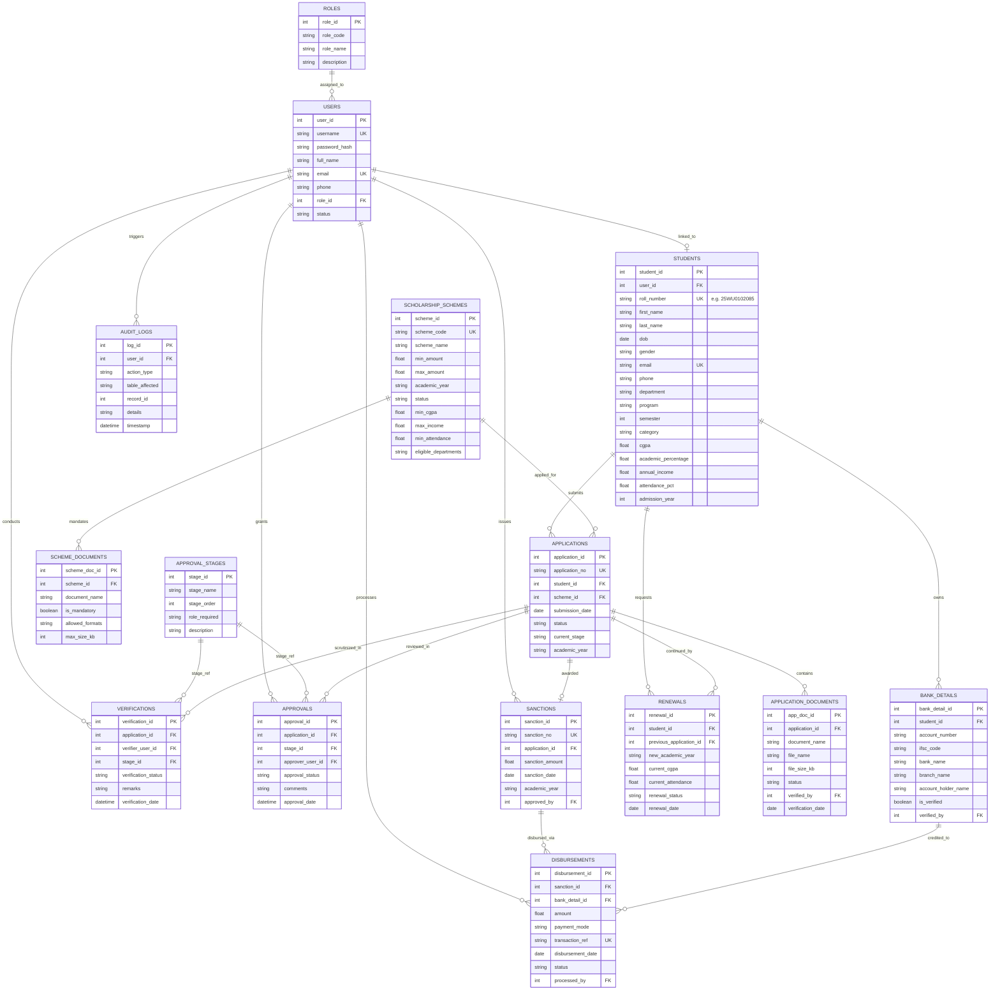

# Entity-Relationship (ER) Diagram & Relational Schema Documentation
### Apex University Scholarship & Financial Aid Management System (SFAMS)

This document provides the complete **Entity-Relationship (ER) Model**, relational cardinalities, data dictionary, and Third Normal Form (3NF) normalization breakdown for the SFAMS database.

---

## 1. Visual ER Diagram (Mermaid)

GitHub natively renders the diagram below:

---

## 2. Relational Schema Data Dictionary

### Table 1: `roles` (System RBAC Roles)
| Column | Type | Constraints | Description |
| :--- | :--- | :--- | :--- |
| `role_id` | `INTEGER` | `PRIMARY KEY AUTOINCREMENT` | Unique Role ID |
| `role_code` | `TEXT` | `NOT NULL UNIQUE` | e.g. `ROLE_ADMIN`, `ROLE_STUDENT`, `ROLE_VERIFIER` |
| `role_name` | `TEXT` | `NOT NULL` | Formal designation name |
| `description` | `TEXT` | `NULLABLE` | Role responsibilities description |

### Table 2: `users` (Authentication & Credentials)
| Column | Type | Constraints | Description |
| :--- | :--- | :--- | :--- |
| `user_id` | `INTEGER` | `PRIMARY KEY AUTOINCREMENT` | Unique User ID |
| `username` | `TEXT` | `NOT NULL UNIQUE` | Unique username / handle |
| `password_hash`| `TEXT` | `NOT NULL` | Account password credential |
| `full_name` | `TEXT` | `NOT NULL` | Full Name of user |
| `email` | `TEXT` | `NOT NULL UNIQUE` | Institutional email |
| `phone` | `TEXT` | `NULLABLE` | Contact phone number |
| `role_id` | `INTEGER` | `FOREIGN KEY -> roles(role_id)` | Assigned RBAC role |
| `status` | `TEXT` | `CHECK(status IN ('Active', 'Inactive', 'Suspended'))` | Account lifecycle state |

### Table 3: `students` (Student Master Records)
| Column | Type | Constraints | Description |
| :--- | :--- | :--- | :--- |
| `student_id` | `INTEGER` | `PRIMARY KEY AUTOINCREMENT` | Unique Student Key |
| `user_id` | `INTEGER` | `FOREIGN KEY -> users(user_id) UNIQUE` | 1-to-1 login link |
| `roll_number` | `TEXT` | `NOT NULL UNIQUE` | Institutional Roll (e.g. `25WU0102085`) |
| `first_name` | `TEXT` | `NOT NULL` | First name |
| `last_name` | `TEXT` | `NOT NULL` | Last name |
| `dob` | `DATE` | `NOT NULL` | Date of birth |
| `gender` | `TEXT` | `CHECK(gender IN ('Male', 'Female', 'Other'))` | Gender classification |
| `email` | `TEXT` | `NOT NULL UNIQUE` | Student email |
| `phone` | `TEXT` | `NOT NULL` | Student phone |
| `department` | `TEXT` | `NOT NULL` | Academic Department |
| `program` | `TEXT` | `NOT NULL` | B.Tech, M.Tech, MCA, etc. |
| `semester` | `INTEGER` | `CHECK(semester >= 1 AND semester <= 10)` | Current semester |
| `category` | `TEXT` | `CHECK(category IN ('General', 'OBC', 'SC', 'ST', 'EWS'))`| Social reservation quota |
| `cgpa` | `REAL` | `CHECK(cgpa >= 0.0 AND cgpa <= 10.0)` | Verified CGPA score |
| `academic_percentage`| `REAL` | `CHECK(academic_percentage >= 0.0 AND academic_percentage <= 100.0)` | Equivalent marks % |
| `annual_income`| `REAL` | `CHECK(annual_income >= 0.0)` | Verified family annual income (INR) |
| `attendance_pct`| `REAL` | `CHECK(attendance_pct >= 0.0 AND attendance_pct <= 100.0)` | Verified semester attendance % |
| `admission_year`| `INTEGER` | `NOT NULL` | Year of enrollment |

### Table 4: `scholarship_schemes` (Financial Aid Schemes)
| Column | Type | Constraints | Description |
| :--- | :--- | :--- | :--- |
| `scheme_id` | `INTEGER` | `PRIMARY KEY AUTOINCREMENT` | Scheme Primary Key |
| `scheme_code`| `TEXT` | `NOT NULL UNIQUE` | Short code (e.g. `SCH-MCM-2026`) |
| `scheme_name`| `TEXT` | `NOT NULL` | Full scheme title |
| `min_amount` | `REAL` | `CHECK(min_amount >= 0)` | Minimum award grant |
| `max_amount` | `REAL` | `CHECK(max_amount >= min_amount)` | Maximum award grant ceiling |
| `academic_year`| `TEXT` | `NOT NULL` | Active session (e.g. `2026-27`) |
| `status` | `TEXT` | `CHECK(status IN ('Active', 'Closed', 'Upcoming'))`| Scheme status |
| `min_cgpa` | `REAL` | `DEFAULT 0.0` | Minimum CGPA threshold |
| `max_income` | `REAL` | `DEFAULT 9999999.0` | Maximum income threshold |
| `min_attendance`| `REAL`| `DEFAULT 75.0` | Mandatory attendance minimum |

### Table 5: `applications` (Scholarship Applications)
| Column | Type | Constraints | Description |
| :--- | :--- | :--- | :--- |
| `application_id`| `INTEGER`| `PRIMARY KEY AUTOINCREMENT` | Application Primary Key |
| `application_no`| `TEXT` | `NOT NULL UNIQUE` | Tracking No (e.g. `APP-2026-001`) |
| `student_id` | `INTEGER` | `FOREIGN KEY -> students(student_id)` | Applying scholar |
| `scheme_id` | `INTEGER` | `FOREIGN KEY -> scholarship_schemes(scheme_id)`| Scheme applied for |
| `submission_date`| `DATE` | `DEFAULT CURRENT_DATE` | Submission timestamp |
| `status` | `TEXT` | `CHECK(status IN ('Submitted', 'Under Verification', 'Verified', 'Approved', 'Sanctioned', 'Disbursed', 'Rejected'))` | 7-Stage lifecycle status |
| `current_stage`| `TEXT` | `NOT NULL` | Active workflow stage |
| `academic_year`| `TEXT` | `NOT NULL` | AY (e.g. `2026-27`) |
| **Constraint** | `UNIQUE(student_id, scheme_id, academic_year)` | Prevents duplicate applications for same scheme in same year |

### Table 6: `sanctions` (Financial Sanction Orders)
| Column | Type | Constraints | Description |
| :--- | :--- | :--- | :--- |
| `sanction_id` | `INTEGER` | `PRIMARY KEY AUTOINCREMENT` | Sanction Primary Key |
| `sanction_no` | `TEXT` | `NOT NULL UNIQUE` | Official Sanction Order No |
| `application_id`| `INTEGER` | `FOREIGN KEY -> applications(application_id)` | Linked application |
| `sanction_amount`| `REAL` | `CHECK(sanction_amount > 0)` | Approved financial sanction |
| `sanction_date` | `DATE` | `DEFAULT CURRENT_DATE` | Date order signed |
| `approved_by` | `INTEGER` | `FOREIGN KEY -> users(user_id)` | Approving Dean ID |

### Table 7: `disbursements` (Direct Benefit Transfer - PFMS)
| Column | Type | Constraints | Description |
| :--- | :--- | :--- | :--- |
| `disbursement_id`| `INTEGER`| `PRIMARY KEY AUTOINCREMENT` | Disbursement Key |
| `sanction_id` | `INTEGER` | `FOREIGN KEY -> sanctions(sanction_id)` | Linked Sanction Order |
| `bank_detail_id`| `INTEGER` | `FOREIGN KEY -> bank_details(bank_detail_id)`| Linked student bank account |
| `amount` | `REAL` | `CHECK(amount > 0)` | Disbursed amount |
| `payment_mode` | `TEXT` | `DEFAULT 'PFMS-DBT'` | Mode of transfer |
| `transaction_ref`| `TEXT` | `NOT NULL UNIQUE` | Bank UTR Reference Number |
| `status` | `TEXT` | `CHECK(status IN ('Processing', 'Completed', 'Failed'))` | Transfer clearance state |
| `processed_by` | `INTEGER` | `FOREIGN KEY -> users(user_id)` | Finance officer ID |

---

## 3. Database Normalization Analysis (3NF Breakdown)

1. **First Normal Form (1NF)**:
   - All table fields contain atomic (indivisible) scalar values.
   - Repeating groups (e.g. multiple uploaded documents per application) are decoupled into `application_documents`.
   - Every table possesses an explicit primary key (`PK`).

2. **Second Normal Form (2NF)**:
   - Achieves 1NF.
   - No partial dependencies: all non-key attributes are fully functionally dependent on the primary key. In junction tables such as `approvals` and `verifications`, audit details depend on the composite event keys or surrogate auto-increment identifiers.

3. **Third Normal Form (3NF)**:
   - Achieves 2NF.
   - Eliminates transitive dependencies ($X \rightarrow Y$ and $Y \rightarrow Z$).
   - Student bank credentials are normalized in `bank_details`, not repeated across `disbursements`.
   - Role metadata is stored in `roles` and referenced by `users.role_id`, preventing update anomalies when modifying role permissions.
   - Schemes, application statuses, and sanctions are decoupled across normalized lifecycle entities.
